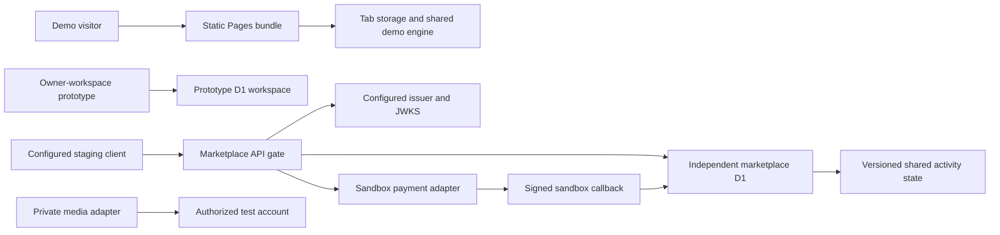

# Production architecture

November 14, 2026. The branch extends the existing repository with an isolated staging boundary and preserves the shared customer interface and demo engine.

## Runtime topology

The staging customer client and external identity tenant require configuration. The existing consumer UI continues to use its demo transport. A browser's fictional role selection supplies no marketplace permission.

## Existing application

`app/connection-app.jsx` owns navigation and request orchestration. `lib/engine.mjs` owns the simulated lifecycle, receipts, feedback and local activities. `pages/transport.mjs` persists tab state and supports explicit temporary recovery after a storage failure. `lib/store.ts` separately persists the owner-workspace prototype in `demo_workspaces`.

The Pages artifact contains browser code and authored media. Provider secrets and marketplace server modules remain outside its entry graph.

## Staging service boundary

The marketplace routes use server configuration, independently verified actors and a separate D1 binding. The authentication verifier in `lib/marketplace/auth.mjs` checks RS256 signatures, exact issuer and intended API audience, expiry, not-before and verified-email claims. Roles and account status come from persisted application records.

Host reviewer, safety, finance and administrator permissions are distinct. Recent verified MFA evidence is required for sensitive staff decisions. The existing Sites identity header adapter remains specific to the prototype.

The route remains closed when its staging enablement, database binding or identity settings are absent. Managed sign-up, account recovery, provider logout and MFA enrollment still need a real tenant and deployed-client integration.

## Data and consistency

`db/marketplace.sql` defines additive `mp_*` tables for users and roles, private host verification references, public profile attributes, per-experience certifications, presence, bookings, claims, events, blocks, favourites, reports, activities, payment records, webhook records, journal entries, refund reviews, feedback, notifications and audit events.

Database constraints protect distinct users and references. A claim is unique by host, customer and booking. Server quote snapshots preserve authoritative price terms. Mutations must keep booking evidence and claims in one atomic database operation.

The local integration harness uses actual SQLite with a D1-compatible prepared-statement and batch surface. Hosted D1 concurrency and failure characteristics still require a staging test. Production migration metadata, retention jobs and reconciliation scheduling require further operational implementation.

The schema preserves the prototype's tables. Apply it to a separate marketplace database. A rollback should restore a verified isolated snapshot or disable the new boundary while preserving its records.

| Requested logical area | Current representation and remaining work |
| --- | --- |
| User, roles and customer profile | Users and roles are persisted. Detailed customer eligibility, preferences and versioned acceptance history still need implementation. |
| Host profile, verification and certification | Separate profile, verification-reference and experience-certification tables. Introduction approval and appeal history remain pending. |
| Availability and presence | Availability flag and latest heartbeat are persisted. Schedules and media-provider attendance evidence remain pending. |
| Booking and participants | Booking contains authoritative customer and host foreign keys. A separate participant-presence lifecycle remains pending. |
| Payment and events | Payment, callback, refund and journal records exist. Full fee, dispute, tip, transfer and payout workflows remain pending. |
| Video room and session presence | No persisted provider room or attendance model is implemented yet. |
| Review, favourite and block | Dedicated records exist. Genuine public statistics require actual eligible delivery evidence. |
| Safety report and case | Report status, assigned reviewer and case event records represent the initial case workflow. |
| Activity, webhook, audit and notification | Dedicated records exist. Background processing, delivery callbacks and retention workers remain pending. |

## Financial boundary

`lib/marketplace/pricing.mjs` snapshots the bounded beta policy, integer cents, quote expiry and allocation parameters. Current defaults are $10 for 15 minutes, $18 for 30 minutes and a 70% base allocation to the host. Tax is explicitly unconfigured.

`lib/marketplace/providers.mjs` constructs test-only payment requests and verifies signed sandbox callbacks. `lib/marketplace/finance.mjs` owns the associated persisted payment state and deduplicated financial events.

Financial journal rows reject updates and deletion. Capture, refund and corrective events retain their history. Provider success and service delivery remain separate facts. The live merchant model, actual fees, disputes, host transfers and payouts need further integration and approval.

## Media and activities

The Daily adapter builds private test-room and participant-token requests. Credentials remain server-side. Room transcription storage and token recording controls, automatic recording and automatic transcription are disabled using the documented properties. A real media client, authoritative provider presence and two-browser delivery evidence remain integration work.

The consumer demo supports authored activity rounds, answer reveal, completion and replay. Those actions stay in the simulation. The marketplace boundary separately persists a participant-authorized activity revision so conflicting writes can be rejected.

## Feedback and analytics

The demo records host ratings, private quality feedback, worth-it responses and safety reports separately. Operations shows value counts over completion-date ranges. Eligible completed paid simulations supply the denominator. Yes/no responses and skipped responses remain distinct.

These local aggregates describe the fictional workspace. Acquisition funnels, repeat-purchase rates, host utilization and contribution calculations need genuine server events and configured analytics.

## Configuration and release

Use the placeholder values in `.env.example` and the configuration descriptions in the root README. Marketplace database and identity configuration must be supplied independently of the demo.

Development stays on the feature branch. The current request does not authorize a change to `main`, a production deployment or real money movement. [Provider decisions](PROVIDER-INTEGRATION-DECISIONS.md) and [readiness checklist](PRODUCTION-READINESS-CHECKLIST.md) describe the next integration gates.

