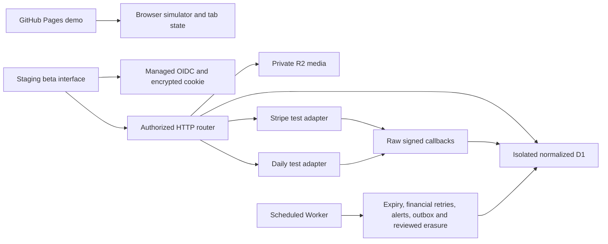

# Production-oriented architecture

November 15, 2026. Current status and remaining limits are recorded in [Master Prompt compliance](MASTER-PROMPT-COMPLIANCE.md).

## Preserved application and separate authority

`app/connection-app.jsx`, the shared demo engine, `pages/transport.mjs` and `docs/index.html` preserve the public simulator. The owner-workspace prototype still uses its own Sites identity boundary and `demo_workspaces`. Its fictional role previews supply no marketplace authority.

`app/beta/` uses `/api/marketplace`. `http-context.ts` fails closed unless the staging mode, enablement and independent binding exist. Hosted OIDC uses authorization code/PKCE, state/nonce, JOSE verification and encrypted HttpOnly cookie sessions; verified Bearer tokens are also supported. A trusted provisioning boundary owns actor provenance. Persisted active status/roles and recent MFA govern sensitive operations. Payloads/identity headers cannot manufacture actors.

`http-router.mjs` centralizes same-origin writes, bounded JSON, quotas, generic failures and request correlation. Logs contain method/status/code/time and a random request ID, not payloads, credentials, narratives or identity data.

## Data and transaction model

Eight additive migrations in `db/marketplace-migrations.mjs` define users/roles; customer eligibility/policy history; host profiles, certifications, verification references, drafts, introductions/photos and appeals; presence; bookings/claims/events; payments/callbacks/refund awards/tips/fees/disputes/transfer references; rooms/attendance/timing; activities; reviews/favorites/blocks/reports/cases; journal/audit/notification/alert records; analytics observations; and privacy requests/holds/leases.

Unique host/customer/booking claims plus atomic D1 batches arbitrate conflicting reservations. Eligibility is checked inside claim creation and acceptance. Active customer status also guards booking creation. Accepted quotes freeze integer-cent totals, version, expiry and base allocation. A declined/expired **unpaid** request can be replaced without changing server-owned preferences; attempted hosts are excluded and replacement replay is linked durably.

D1 is retained because its prepared statements, constraints and atomic batch surface fit the current Worker. Actual SQLite transactions test invariants locally; Wrangler verifies the eight migrations against local D1. Those tests do not establish hosted contention, deployment limits or load behavior. Hosted D1 testing may justify a coordination primitive or another relational deployment; no speculative stack migration is introduced.

## Financial and delivery facts

`finance.mjs` records verified sandbox captures separately from delivery. Base/tip refund totals move monotonically, append immutable deltas, preserve original events and compensate earned allocations proportionally. Immutable awards and dispatch snapshots freeze reviewed refund amounts. Fees/disputes remain separate from principal. `payouts.mjs` reserves settled journal liabilities, requires another finance approver and reconciles test connected-account transfer/reversal references. It does not send bank payouts.

`sessions.mjs` binds paid bookings to private rooms and short-lived participant grants. It checks both account eligibility and host certification before/after provider token creation. Signed provider attendance determines overlapping delivery, including unioning simultaneous connections. Reconnect does not restart time. Zero-attendance paid bookings expire even when no room was requested. Insufficient delivery opens review rather than awarding a full completed session. Provider room cleanup is retried.

Activities use participant-owned server revisions and reject stale writes. Rating, private quality feedback, value and safety reports remain separate. Only eligible completed sessions contribute ordinary public statistics.

## Operations, analytics and privacy

Scoped staff services review hosts, media, cases, refunds, transfer exceptions, account status and privacy requests. Safety reviewers can protectively suspend an account only through an assigned open case; finance permission does not grant safety narratives. Revocation removes room eligibility and new matching; pending cleanup remains explicit.

The outbox leases deliveries, retains stable idempotency keys, bounds backoff and stops after five attempts. The scheduled Worker reconciles expiry/financial work, scoped alerts, visitor expiry, quotas and reviewed privacy processing. Alert outbox failures cannot recursively create alert chains. Actual scheduling/delivery/receipt still need staging evidence.

`analytics.mjs` derives outcomes from records and authoritative event triggers, and defines match latency, mature 7/30-day repeats, rebooking, observed host utilization and journal contribution. Visitor conversion is opt-in, unlinkable to account IDs and labeled for incomplete retained coverage. No missing-data result is replaced by an invented success rate.

Account closure and erasure are separate. Closure revokes access immediately; private erasure is leased, policy-versioned and held for unresolved safety/finance/legal evidence. Identity hashes block reprovisioning, including concurrent closure. R2 deletion and database redaction cannot be one transaction; [privacy operations](PRIVACY-RETENTION-OPERATIONS.md) documents the boundary.

## Release and recovery

The static bundle cannot run server routes. The example staging configuration has isolated bindings, no secrets and disabled defaults. Local scripts never deploy. Restore to a separate database and verify ownership, claims, callback/financial evidence and foreign-key integrity before traffic resumes. Production activation remains dependent on provider/merchant approval, policies, staff coverage, hosted verification and explicit authorization.
